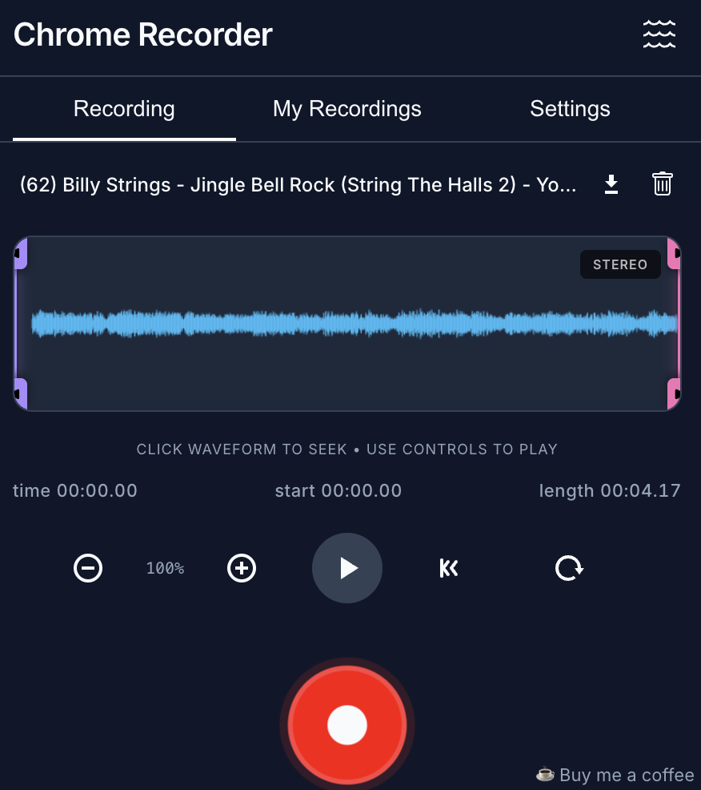
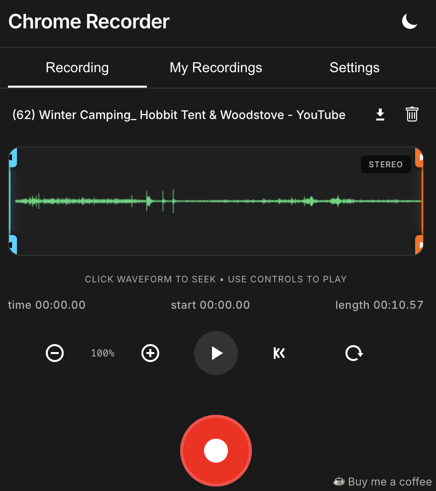
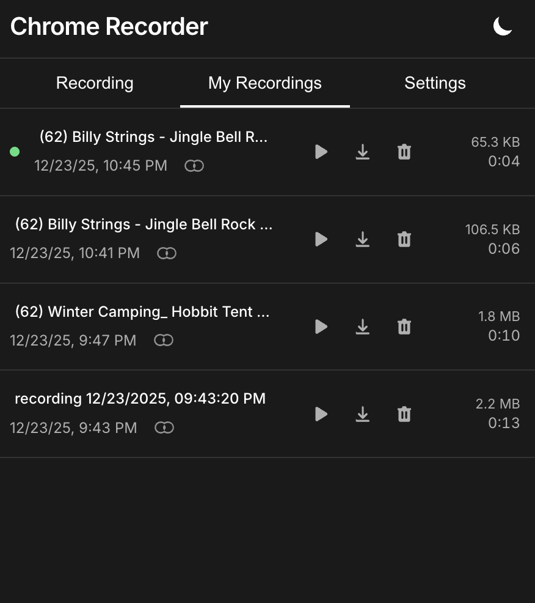
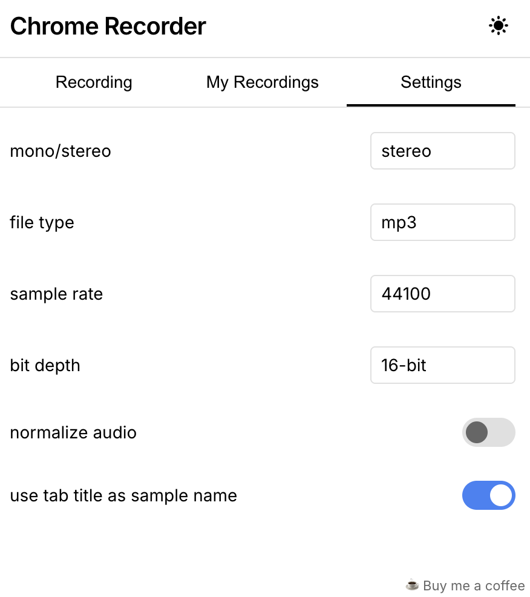

# Chrome Recorder - Chrome Extension

A Chrome extension for recording browser audio output with waveform visualization, playback controls, format conversion, and extensible audio processing. 100+ Users!!!

**[Install from Chrome Web Store](https://chromewebstore.google.com/detail/chrome-recorder/bfmjmjjaiefmjalpplfjeiiicddojdpf?hl=en&authuser=0)**

<div align="center">
  <table>
    <tr>
      <td width="50%" align="center">
        <br>
        <em>Recording View (Theme 1)</em>
      </td>
      <td width="50%" align="center">
        <br>
        <em>Recording View (Theme 2)</em>
      </td>
    </tr>
    <tr>
      <td width="50%" align="center">
        <br>
        <em>My Recordings Screen (Theme 2)</em>
      </td>
      <td width="50%" align="center">
        <br>
        <em>Settings (Theme 4)</em>
      </td>
    </tr>
  </table>
</div>

## Features

### Recording
- **Automatic Tab Audio Capture**: Records audio from the current Chrome tab automatically without requiring user selection.
- **Non-Muting Recording**: Audio continues to play through your speakers/headphones while recording.
- **Background Recording**: Recording continues even when the extension popup is closed.
- **Real-time Waveform Visualization**: See live, high-performance waveform visualization while recording.
- **Optimized Internal Storage**: Recordings are stored internally as WAV to ensure zero-loss quality and eliminate the need for re-conversion when changing export preferences.
- **Tab Title Naming**: Optional automatic naming using the current tab title (available in Preferences).

### Playback & Controls
- **Play/Pause Controls**: Standard audio playback controls.
- **Waveform Scrubbing**: Click anywhere on the waveform to seek to that position.
- **Non-Destructive Trimming**: Use handles on the waveform to select a specific region. Trim values are automatically persisted and restored for each recording.
- **Smooth Playhead**: Interpolated playhead movement for smooth visual updates.
- **Vertical Zoom**: Zoom in/out to increase the waveform's vertical height for detailed manual alignment and viewing.
- **Persistence & Restore**: Each recording restores its last used trim values and play position when reloaded.
- **Return to Start**: Reset playback position to the beginning (or start of trim).
- **Loop Playback**: Toggle loop mode for continuous playback of the selected region.

### Format & Preferences
- **Full Format Support**: Record and export in **WAV**, **WEBM**, **MP3**, or **OGG** formats.
- **MP3 Encoding**: High-quality MP3 encoding using `lamejs`.
- **Sample Rate Selection**: Choose from 44.1kHz, 48kHz, 96kHz, or 192kHz.
- **Channel Mode**: Select mono or stereo.
- **Bit Depth (WAV)**: Choose 16-bit, 24-bit, or 32-bit for exports.
- **Volume Normalization**: Optional automatic peak normalization to maximize loudness without clipping.
- **Instant Configuration**: Preferences change export behavior on-the-fly without requiring re-processing of the original recording.
- **Persistent Preferences**: All settings are saved and persist across sessions.

### Recent Recordings
- **IndexedDB Storage**: Uses IndexedDB for high-capacity, virtually unlimited storage of recordings.
- **Metadata View**: See file sizes, duration, timestamps, and channel modes (mono/stereo) at a glance.
- **Auto-Update**: Recordings list updates automatically when preferences (like format) change.
- **Quick Access**: Play, download, or delete any recording from your history.

### UI/UX
- **Modern Design**: Sleek, clean interface using the Inter font.
- **Multiple Themes**: Choose between **Dark**, **Light**, **Midnight**, and **Forest** themes, each with unique icons and color palettes.
- **Minimalist Iconography**: Custom-designed theme icons (Sun, Moon, Wave, Tree) and a unified multi-color extension icon representing all themes.
- **Dynamic Visuals**: Processing state indicators, pulsing recording button, and live waveform processing.
- **Responsive Layout**: Optimized to fit perfectly within the extension popup without unnecessary scrolling.

## Installation

Choose one of the following options to install the extension:

### Option A: Chrome Web Store (Recommended)
The easiest way to install and get automatic updates.

1. Visit the **[Chrome Web Store](https://chromewebstore.google.com/detail/chrome-recorder/bfmjmjjaiefmjalpplfjeiiicddojdpf?hl=en&authuser=0)**.
2. Click **Add to Chrome**.

---

### Option B: Build from Source (Latest Version)
Use this option for development or to get the very latest improvements and features.

#### Prerequisites
- **Node.js**: v14 or higher
- **Package Manager**: npm or yarn

#### Instructions
1. **Clone the repository**:
   ```bash
   git clone <repository-url>
   cd AudioSplitterChromeExtension
   ```
2. **Install dependencies**:
   ```bash
   npm install
   ```
3. **Build the extension**:
   ```bash
   npm run build
   ```
4. **Load in Chrome**:
   - Open Chrome and navigate to `chrome://extensions/`.
   - Enable **Developer mode**.
   - Click **Load unpacked** and select the `dist` directory generated in the previous step.

## Usage

### Recording Audio

1. **Start Recording**:
   - Click the extension icon in Chrome's toolbar.
   - Click the red circular record button.
   - The button transforms into a square stop button while recording and pulses.

2. **During Recording**:
   - Audio continues playing normally.
   - Real-time waveform visualization appears.
   - Recording continues even if you close the popup.

3. **Stop Recording**:
   - Click the square stop button.
   - The full waveform appears with trim handles.
   - Recording is automatically saved to Recent Recordings.

### Playing & Editing

- **Play/Pause**: Use the play button in the center.
- **Trim**: Drag the colored handles at the start and end of the waveform to select a region.
- **Seek**: Click anywhere on the waveform to jump to that position.
- **Zoom**: Use the `+` and `-` buttons to adjust the vertical scale of the waveform.
- **Loop**: Toggle loop mode to repeat the trimmed area.

### Managing Recordings

- **Recent Recordings**: Click the center tab to view history.
- **Play/Load**: Click a recording's name or the play icon to load it into the main view.
- **Download**: Click the download icon. It will use your current format/sample rate preferences.
- **Delete**: Click the trash icon to permanently remove a recording.


### Preferences

- **mono/stereo**: Switch between 1 and 2 channels.
- **file type**: Choose your export format (WAV, WEBM, MP3, OGG).
- **sample rate**: Up to 192kHz for high-fidelity capture.
- **bit depth**: Configurable for WAV files (16/24/32-bit).
- **normalize**: Peak normalization for consistent volume.
- **use tab title**: Automatically use the current tab's name for new recordings.

## Technical Details

### Architecture

- **Frontend**: React + TypeScript
- **Build Tool**: Webpack
- **Audio Engine**: 
  - `MediaRecorder` (Opus in WebM) in an offscreen document, with an `AudioWorklet` measuring waveform peaks.
  - WebCodecs (`AudioDecoder` / `AudioEncoder`) for streaming decode and Opus re-encoding.
  - `lamejs` in a Web Worker for MP3 encoding.
  - Custom streaming writers for WAV (16/24/32-bit, RF64 above 4 GB), Ogg Opus and WebM.
- **Chrome APIs**: 
  - `chrome.tabCapture` - For capturing tab audio.
  - `chrome.offscreen` - For recording that continues when the popup is closed.
  - `chrome.storage.local` - For preferences, recording state and a short diagnostics log.
  - `chrome.storage.session` - For temporary UI state.
- **Storage Strategy**: 
  - **IndexedDB**: recordings are stored as the original compressed WebM/Opus (about 58 MB per hour) and converted only when downloaded.
  - **Crash-safe recording**: audio is written to IndexedDB every second while recording; interrupted recordings are recovered the next time the popup opens.
  - **Streaming export**: downloads are decoded and encoded in small blocks, so memory use does not grow with recording length. Long exports run in their own tab.

### Limits

- Recordings stop and save automatically after 1 hour (paused time doesn't count).
- Requires Chrome 116 or later.

### Permissions

- `tabCapture` - To capture audio from browser tabs.
- `tabs` - To access current tab information for naming.
- `activeTab` - To interact with the current active tab.
- `offscreen` - To record in the background while the popup is closed.
- `storage` / `unlimitedStorage` - To save recordings and preferences without hitting the default storage quota.

## Testing

```bash
npm test
```

Builds the extension and runs the Playwright suite in Chromium:

- `tests/pipeline.spec.ts` records a synthetic tone (with a pause) through the same MediaRecorder and peak-worklet setup the extension uses, then checks recovery, seeking and every export format by decoding the output.
- `tests/extension.spec.ts` loads `dist/` as an unpacked extension and checks the popup, crash recovery, the export tab download and the bug-report diagnostics.

Starting a real tab recording needs a user click on the extension, which automation can't do, so test record/pause/stop on a real tab by hand before releasing.

## Experimental & Future Features

> [!IMPORTANT]
> The features listed below are experimental and may not be fully implemented or available on the current branch.

### AI Stem Splitting & Sound Isolation
We are exploring the integration of high-performance AI models and APIs (such as **Suno** or other stem-splitting engines) to enable advanced audio manipulation. Potential experimental features include:
- **Lead Vocal & Instrumental Separation**: Isolate vocals or backing tracks from any recording.
- **Sound Isolation**: Use AI to extract or remove specific sound events (e.g., background noise, specific instruments) from captured audio.
- **Advanced Stem Export**: Download recordings separated into multiple high-fidelity tracks.

## License

MIT

## Contributing

Contributions are welcome! Please feel free to submit a Pull Request.
